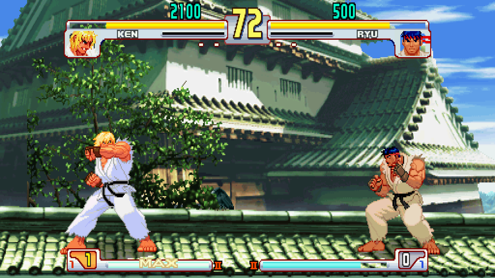
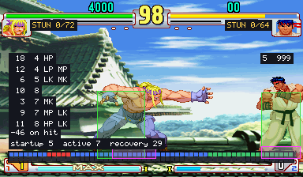
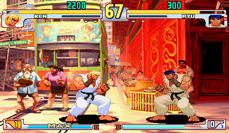

# sf3comp

A native port of Capcom's **Street Fighter III** arcade games (CPS-3), made by static recompilation: the game's SH-2
program becomes C++ that runs on a machine written for this project, not an emulator.

The aim is one definitive Street Fighter III: **3rd Strike**'s gameplay, with the stages, music and more of
**New Generation** and **2nd Impact**. The first milestone is 3rd Strike on its own, with the features of the CPS-2
ports ([CPS-2 Recomp](https://github.com/tmcleroy/cps2recomp)): training mode, online play, widescreen and the rest.

**Status:** early. 3rd Strike runs as translated code on the port's own CPS-3 machine, with the launcher, the in-game
menu, save states, free play, the CPS-2 ports' display options, widescreen (or 16:9 played exactly as on the board,
with invisible walls), a training mode (hit boxes, input display, frame meter and frame data, damage and stun
readouts, a dummy that guards, parries, escapes throws and quick-stands), a survival mode, a custom soundtrack (your
own music files in place of the game's, by song or as a playlist) and online play with rollback (checked on one
machine so far). A stage option fights 3rd Strike on New Generation's and 2nd Impact's stages, with their music
([games/sfiii3/DEFINITIVE.md](games/sfiii3/DEFINITIVE.md)).

| Widescreen | Training mode | A 2nd Impact stage |
| --- | --- | --- |
|  |  |  |

**No game files are included.** You need your own ROM set (`sfiii3nr1`, Japan 990512). Its cipher's keys are worked out from the set
itself when the game starts; none are in this repository.

## Layout

```
cps3recomp/   the CPS-3 toolkit: machine/ (SH-2, board, cipher, ROM set, flash), video/, sound/, port/, tools/
games/sfiii3/ 3rd Strike: game.cfg, src/, PROGRESS.md
work/, build/ generated from your ROM set, never committed
```

## Building

```sh
cmake -S . -B build/sfiii3 -G Ninja && ninja -C build/sfiii3
./build/sfiii3/sfiii3-launcher                      # or: ./build/sfiii3/sfiii3 --rom path/to/sfiii3n.zip
sh cps3recomp/tools/make_app.sh sfiii3              # macOS: build/sfiii3/Street Fighter III 3rd Strike.app
```

GPL-3.0. Not affiliated with Capcom.
